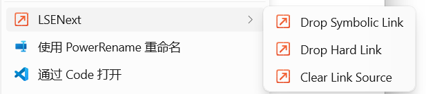

# LSENext (Link Shell Extension Next)

<p align="center">
  
</p>

<p align="center">
  <strong>A modern Windows 11 Explorer Shell Extension — Link Shell Extension (LSE) Successor</strong><br>
  Create Symbolic Links, Directory Junctions, and Hard Links directly from Windows 11's top-level context menu.
</p>

<p align="center">
  <a href="https://github.com/SunnyYYLin/LSENext/releases/latest"></a>
  <a href="https://github.com/SunnyYYLin/LSENext/actions/workflows/ci.yml"></a>
  <a href="LICENSE"></a>
  
  
</p>

---

[English](#english) | [简体中文](#简体中文)

---

<a name="english"></a>
## English

### ✨ Key Features

- **Native Windows 11 Top-Level Context Menu**: Built with Windows 11 Sparse Package (`Package Identity`) and modern `IExplorerCommand` COM interfaces. Directly visible in the primary context menu without clicking *"Show more options"*.
- **Comprehensive Link Types**:
  - **Symbolic Links (Symlink)**: Supports both files and directories, cross-volume links, and relative path symlinks.
  - **Directory Junctions**: Native NTFS junctions for folders.
  - **Hard Links**: File hard links on the same NTFS partition.
- **Intuitive Workflow**:
  - **Pick & Drop**: Right-click any file/folder and select **"Pick Link Source"**, then navigate to any folder or whitespace and right-click to drop your desired link.
  - **Whitespace / Background Support**: Drop links directly in Explorer folder whitespace without having to target a child item.
- **Windows Developer Mode Integration (No-UAC Symlinks)**:
  - Automatically detects Windows Developer Mode on install and update.
  - Prompts with a 1-click shortcut to Windows Settings to enable Developer Mode.
  - When Developer Mode is enabled, **symbolic links are created instantly without any UAC elevation prompts**.
  - Graceful UAC fallback elevation when Developer Mode is off or administrative rights are required.
- **Pure Rust & Lightweight**: 100% written in Rust for safety, zero runtime bloat, and millisecond responsiveness.
- **Multi-Architecture**: Native Windows binaries for both **x64** and **ARM64** (including Copilot+ PCs with Snapdragon X Elite).
- **Standard MSI Installer**: Built with WiX Toolset for seamless per-machine installation, upgrades, and clean uninstallation.

---

### 📸 Demo



---

### 📊 Link Types Quick Reference

| Link Type | Supports Files | Supports Dirs | Cross-Volume | Admin / UAC Required? |
| :--- | :---: | :---: | :---: | :--- |
| **Symbolic Link** | ✅ | ✅ | ✅ | **No UAC** with Developer Mode; UAC required otherwise |
| **Relative Symlink** | ✅ | ✅ | ✅ | **No UAC** with Developer Mode; UAC required otherwise |
| **Directory Junction** | ❌ | ✅ | ✅ | **Never requires UAC** (native NTFS standard user privilege) |
| **Hard Link** | ✅ | ❌ | ❌ (Same drive only) | **Never requires UAC** |

---

### 🚀 Installation & Upgrade

Download the latest installer from [GitHub Releases](https://github.com/SunnyYYLin/LSENext/releases/latest):
- **x64**: `LSENext-<version>-x64-release.msi`
- **ARM64**: `LSENext-<version>-arm64-release.msi`

#### Upgrading Notes: "Files in Use (COM Surrogate)"
When upgrading LSENext while File Explorer is open, Windows may display a **"Files in Use - COM Surrogate"** dialog.
- This is **completely normal**: Windows 11 isolates shell extensions inside `dllhost.exe` (COM Surrogate) which locks active DLLs.
- Simply leave the default option selected (**"Close the applications and attempt to restart them"**) and click **OK**. The installer will close `COM Surrogate` and update the files without requiring a reboot.

#### Windows Defender / SmartScreen False Positives
Because LSENext is a newly compiled open-source tool without an expensive commercial EV certificate, Windows Defender's heuristic AI model may occasionally flag new builds (e.g. `Trojan:Win32/Wacatac.B!ml` where `!ml` means Machine Learning).
- Click **"More info" -> "Run anyway"** on SmartScreen, or add the installation folder to Defender's exclusion list.
- All code is 100% open-source and built transparently on GitHub Actions.

---

<a name="简体中文"></a>
## 简体中文

### 💡 项目简介

**LSENext** 是经典 Windows 工具 **Link Shell Extension (LSE)** 的现代化继承者，专为 **Windows 11 原生一级右键菜单** 打造。

采用纯 Rust 编写，通过 Windows 11 稀疏包（Sparse Package / Package Identity）技术与现代 `IExplorerCommand` COM 接口，告别旧版 Win10 冗长的“显示更多选项”，在原生菜单中极速创建各种软链接、硬链接和目录联接。

---

### ✨ 核心特性

- 🎯 **原生 Windows 11 一级菜单**：直接在 Win11 新版右键菜单中显示，无需点击“显示更多选项”。
- 🔗 **全功能链接类型支持**：
  - **符号链接（Symbolic Link）**：支持文件与文件夹，支持绝对路径与相对路径（Relative Symlink），支持跨盘符。
  - **目录联接（Directory Junction）**：NTFS 原生目录软链接，跨盘整理文件夹利器。
  - **硬链接（Hard Link）**：同分区文件级硬链接，共享同一份物理数据。
- 🖱️ **灵活直观的交互**：
  - **选取与放置（Pick & Drop）**：右键文件/文件夹选择「选取链接源」，在目标文件夹右键或空白处直接选择「放置为符号链接 / 目录联接 / 硬链接」。
  - **文件夹空白处支持**：在任何打开的文件夹空白背景处直接右键即可放置链接。
- ⚡ **Windows 开发人员模式深度整合（符号链接免 UAC）**：
  - 安装与升级后自动检测系统是否开启「开发人员模式」；
  - 若未开启，提供一键直达系统设置的友好指引；
  - 开启开发人员模式后，创建符号链接**全程无需管理员提权 (UAC)，毫秒级瞬时完成**；
  - 若未开启开发人员模式，自动触发优雅的 UAC 提权兜底，确保操作成功。
- 🦀 **纯 Rust 构建**：零运行时依赖，占用内存低至几兆，无任何后台常驻进程。
- 💻 **双架构原生支持**：同时提供 **x64** 和 **ARM64**（如搭载骁龙 X Elite 的 Copilot+ PC）原生版本。
- 📦 **标准 MSI 安装包**：基于 WiX Toolset 构建的标准 Windows Installer 安装程序，升级平滑、卸载干净。

---

### 📖 链接类型对比与权限说明

| 链接类型 | 支持文件 | 支持目录 | 支持跨盘符 | 权限要求与 UAC 提示 |
| :--- | :---: | :---: | :---: | :--- |
| **符号链接 (Symbolic Link)** | ✅ | ✅ | ✅ | **开启开发者模式后免 UAC**；默认模式需管理员提权 |
| **相对符号链接 (Relative Symlink)** | ✅ | ✅ | ✅ | **开启开发者模式后免 UAC**；父文件夹移动时链接不失效 |
| **目录联接 (Directory Junction)** | ❌ | ✅ | ✅ | **原生完全免 UAC**（普通用户在拥有写权限目录即可创建） |
| **硬链接 (Hard Link)** | ✅ | ❌ | ❌ (限同分区) | **原生完全免 UAC** |

---

### ❓ 常见问题与解答 (FAQ)

#### Q1: 覆盖安装或更新时弹出「Files in Use - COM Surrogate」？
**答：这是完全正常的现象。**  
Windows 11 为了防止第三方右键扩展闪退导致资源管理器崩溃，将右键菜单插件隔离运行在 `dllhost.exe` (`COM Surrogate`) 进程中。当你在更新前打开过资源管理器，旧版 DLL 会被锁定。  
👉 **解决方法**：保持默认选中的 **「Close the applications and attempt to restart them」**，直接点击 **OK** 即可，安装程序会在 1 秒内自动接管并完成更新，**无需重启电脑**。

#### Q2: Windows Defender 报毒或 SmartScreen 拦截？
**答：这是杀毒软件对全新开源工具的“机器学习（!ml）”误报。**  
- LSENext 是纯 Rust 原生编译的开源程序，没有购买昂贵的商业代码签名证书，在全网新发布时安全信誉分（Reputation）为 0；
- 加上程序具备“外壳扩展注入、UAC 提权、检测开发者模式注册表”等系统级管理行为，极易命中 Defender 的云端启发式模型（常见名称如 `Wacatac.B!ml`，后缀 `!ml` 即 Machine Learning 误报）。
👉 **解决方法**：在 SmartScreen 提示中点击 **“更多信息” -> “仍要运行”**，或在 Windows 安全中心的保护历史记录中选择“在设备上允许”。所有源码完全透明，并由 GitHub Actions 自动化编译发布。

#### Q3: 如何彻底关闭创建符号链接时的 UAC 弹窗？
**答：只需打开 Windows 的「开发人员模式」即可。**  
1. 按 `Win + I` 打开系统设置；
2. 进入：**系统 -> 开发者选项**（Windows 11）或 **更新和安全 -> 开发者选项**（Windows 10）；
3. 打开 **「开发人员模式」** 开关。  
*(开启后即刻生效，无需重启电脑)*

---

### 🛠️ 源码构建 (Build from Source)

本项目支持本地单元测试与 GitHub Actions 跨平台自动化编译：

```powershell
# 运行单元测试（支持 Linux / Windows）
cargo test --workspace

# 本地 Windows 打包（需 .NET SDK 与 Windows SDK）
powershell -ExecutionPolicy Bypass -File scripts\package.ps1 -Architecture x64 -Configuration release
```

自动化构建由以下 GitHub Actions 工作流承载：
- `.github/workflows/ci.yml`：代码检查与跨平台测试
- `.github/workflows/alpha.yml`：提交到 `main` 分支时自动构建 Alpha 预发布包
- `.github/workflows/release.yml`：打标签时自动编译并发布 GitHub Release

---

### 📄 开源许可 (License)

本项目基于 [MIT License](LICENSE) 开源。
